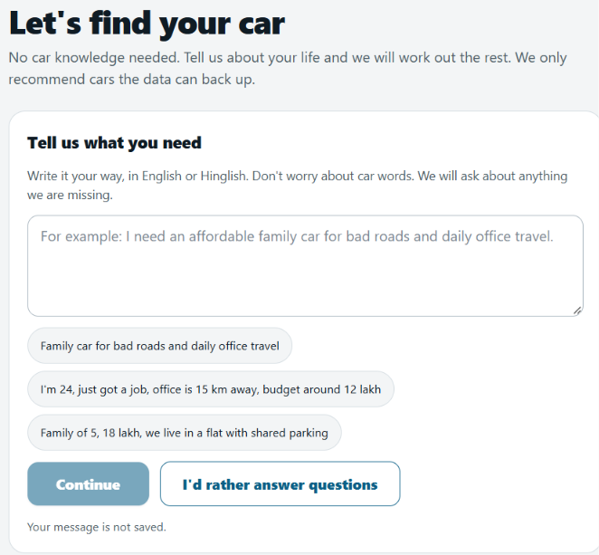
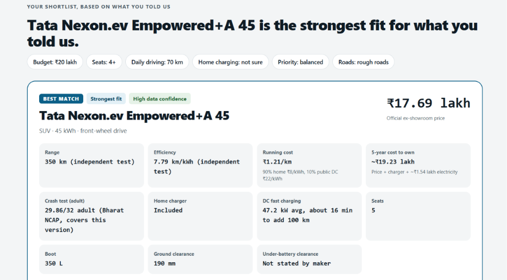
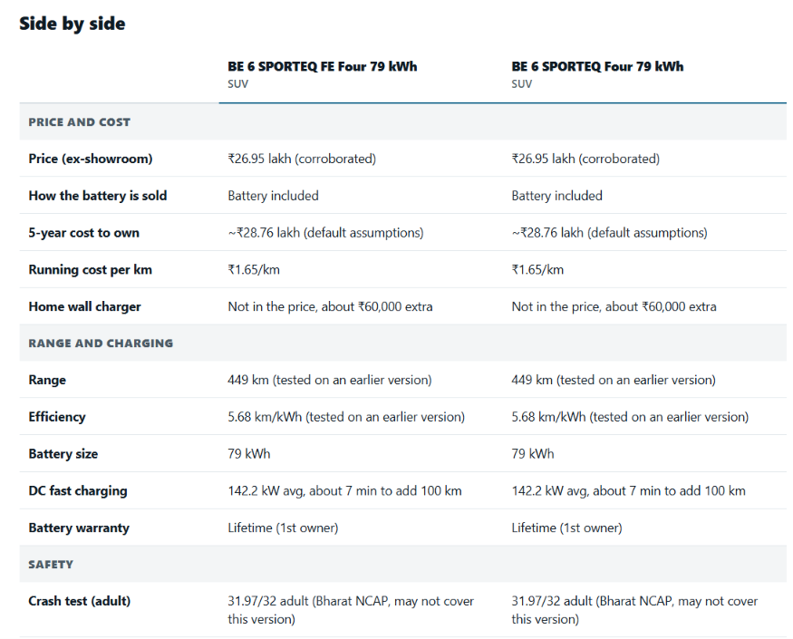
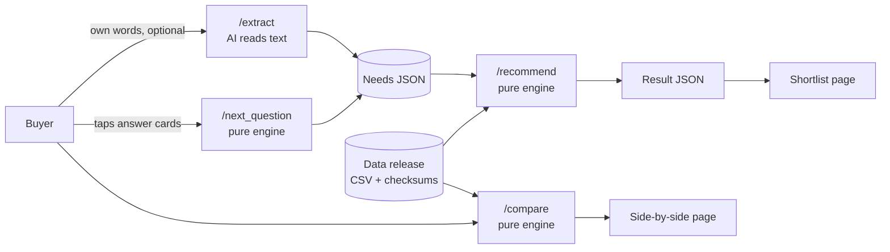

<div align="center">

# AutoBrain

### Honest, evidence-backed EV buying advice for people who know nothing about cars.

Tell us about your life. Answer a few easy questions. Get a shortlist you can trust, with every claim backed by data and every gap admitted.


[See it](#see-it) | [How it works](#how-it-works) | [Features](#features) | [Quick start](#quick-start) | [Architecture](#architecture) | [The rules we never break](#the-rules-we-never-break) | [Docs](#documentation)

</div>

---

## See it

**Start in your own words.** No car terms needed. Type it your way (English or Hinglish), tap an example, or answer a few easy questions instead. We ask only about what we are missing.

<p align="center">
  
</p>

**Your shortlist.** The best match comes with its reason, the evidence behind every figure, and what is *not* stated by the maker.

<p align="center">
  
</p>

**Side by side.** Compare two or three cars straight from the data. Every cell states its basis, such as "tested on an earlier version", so nothing is passed off as more certain than it is.

<p align="center">
  
</p>

---

## Why AutoBrain exists

Car websites ask you for "ADAS", "ground clearance" and "NCAP rating" before they will help you. A first-time buyer ends up searching every term, and then they are no better off than with a spec sheet.

AutoBrain flips that. You describe your life in plain words ("family of four, bad roads, office 15 km away, around 12 lakh"), and the system asks only the easy questions it still needs. Our own code turns your answers into the technical requirements. Then a deterministic engine reads a verified data release and shows you the cars that fit, why, and what is **not** confirmed.

> **Trust is the product.** If the maker has not stated something, we say "Not stated by maker". We never fill the gap with a guess.

## Features

| | |
| --- | --- |
| **Plain-language intake** | No car knowledge needed. Tap answer cards, type in English or Hinglish, or use the small helpers (EMI to budget, commute minutes to daily km) with their assumptions shown on screen. |
| **Questions only when they matter** | The engine asks the four required questions in order, then an optional one (roads, what matters most, long trips) only if the answer would change your shortlist. |
| **An honest shortlist** | Best match, a step up, a strong alternative, an in-between, a "don't overpay" pick and "why not these", each with reasons, trade-offs and watch-outs. |
| **Side-by-side comparison** | Pick two or three cars from the real data and see where each one leads. Winners are named only when the figures are like for like, and there is never an overall winner. |
| **Evidence labels everywhere** | Price status, efficiency basis and crash-test status sit right next to the numbers they qualify. |
| **Works with the AI switched off** | The AI only reads typed text and rewords one car's facts. The whole flow runs on forms and templates without it. |
| **Mobile-first** | Built for a 390 px phone, with a "Download as PDF" for the results. |

## How it works



1. **Start.** Electric car or not. Only electric is covered today. Then: find the right EV, or compare cars you have already shortlisted.
2. **Understand.** The buyer's own words, if any, are read by an AI that only fills in what was clearly said. Everything is validated against a strict contract; anything invalid is dropped.
3. **Ask.** The engine picks one easy follow-up at a time. Required: budget, seats, daily driving, home charging. Optional: only if it changes the top three cars.
4. **Recommend.** Three layers, no AI: *eligibility* (pass, fail or unknown), *fit* (a score), and *evidence confidence* (how much the data can be trusted for that car).
5. **Explain.** Reasons, trade-offs and watch-outs, with anything unverified called out.

The full explanation, every assumption and a worked example are in [`docs/HOW_IT_WORKS.md`](docs/HOW_IT_WORKS.md).

## The rules we never break

These protect the one thing that makes the product worth using. They are enforced in code and in tests, and written down in [`AGENTS.md`](AGENTS.md).

- **Car data comes only from the newest folder in `data/releases/`.** Nothing is hardcoded, guessed, scraped or invented. The engine validates columns, keys, allowed values and SHA-256 checksums at startup and refuses to start on a critical error.
- **The recommendation engine is pure, deterministic Python.** Same input, same output. No AI call inside it.
- **The AI never ranks, scores, picks a car or supplies a number.** Any number in AI text that is not in the engine's result is discarded and replaced by a template sentence.
- **Unknown stays unknown.** Blank or "Not stated" is never treated as yes or no, and is always shown as "Not stated by maker".
- **No apples-to-oranges.** A battery-rental (BaaS) price is never compared with a battery-included price. A tested range is never compared with a maker's own figure. A petrol or diesel crash rating is never applied to an EV.
- **A guess is never a requirement.** "Not sure" stays unknown, and situation answers never create must-haves.
- **Buyer text is data, never instructions.** It is never logged, and it is kept out of the explanation step.

## Quick start

**You need:** Python 3.12+ and Node.js 20+.

```bash
git clone https://github.com/PriyanshuTiwariii/AutoBrain.git
cd AutoBrain
cp .env.example .env        # Windows PowerShell: copy .env.example .env
```

Open `.env` and set `ENGINE_SECRET` to any private phrase that is not `change-me`. The engine refuses to start without it. The AI settings are optional: leave them empty and everything still works.

**Terminal 1: the engine** (port 8000)

```bash
cd engine
pip install -r requirements.txt
python -m uvicorn app.main:app --reload --port 8000
```

Check it at <http://localhost:8000/health>. Interactive API docs are at <http://localhost:8000/docs>.

**Terminal 2: the website** (port 3000)

```bash
cd web
npm install
npm run dev
```

Open <http://localhost:3000>.

> Do not run `npm run build` while `npm run dev` is running; they share the `.next` folder. Set `NEXT_DIST_DIR` to build somewhere else.

### Configuration

All settings live in one root `.env` file, read by both services. See [`.env.example`](.env.example) for every option with comments.

| Variable | Needed? | What it does |
| --- | --- | --- |
| `ENGINE_SECRET` | **Yes** | Shared secret the website sends with every request. |
| `ENGINE_URL` | No | Where the website finds the engine (default `http://localhost:8000`). |
| `DATA_RELEASE_DIR` | No | Which data release the engine loads. |
| `OPENAI_API_KEY`, `LLM_MODEL_PRIMARY`, `LLM_MODEL_FALLBACK` | No | Turn on the "describe what you need" box. Empty means the questions work on their own. |
| `NEXT_PUBLIC_FEEDBACK_FORM_URL` | No | Adds a "Tell us if this helped" link on the results page. |

### Run the tests

```bash
cd engine && python -m pytest          # engine: pure functions, contracts, API, golden scenarios
cd web && npm test && npx tsc --noEmit # website: logic, routes, rendering, type check
```

## Architecture

```
browser ──► website (Next.js, :3000) ──server route──► engine (FastAPI, :8000)
                                        adds X-Engine-Secret        │
                                                                    ▼
                                                  data/releases/<newest>/  (CSV + manifest)
```

- The browser only ever talks to the website. The engine's address and secret live in the website's **server** code and never reach a visitor (a test checks this).
- The engine holds the data release in memory and has no database and no sessions, so it is stateless.
- **Contracts first.** [`contracts/*.schema.json`](contracts) are the source of truth for every request and response. Change a contract, then the Pydantic models, then the TypeScript types.

### Engine routes

| Route | Purpose | Uses AI? |
| --- | --- | --- |
| `GET /health` | Release, row counts, engine version. | No |
| `POST /recommend` | Needs in, shortlist out. | No |
| `POST /next_question` | What is known so far in, the next easy follow-up out. | No |
| `GET /cars` | Every variant in the release, for the comparison pickers. | No |
| `POST /compare` | Two or three cars in, facts and fair category winners out. | No |
| `POST /extract` | Buyer's own words in, validated needs out. Optional. | **Yes** (the only one) |

### Website pages

| Page | What it does |
| --- | --- |
| `/` | Landing page. |
| `/start` | "What kind of car?" Electric, or petrol and diesel (not covered yet). |
| `/start/ev` | Find the right EV, or compare EVs you have shortlisted. |
| `/find` | The guided questions. `/find/advanced` is the full form for people who know cars. |
| `/compare` | Pick two or three cars and compare them. The URL is shareable. |
| `/r` | The shortlist: cards, watch-outs, side-by-side table, PDF download. |

## Repository layout

```
AutoBrain/
├── AGENTS.md            Rules for contributors and coding agents (non-negotiable)
├── CHANGES.md           The latest decisions; wins over other docs
├── HANDOFF.md           Start here if you are new
├── BACKLOG.md           Things decided for later
├── contracts/           JSON schemas for every request and response
├── data/
│   ├── master/          AutoBrain_EV_Data.xlsx: the ONLY place car data is edited
│   ├── scripts/         enrich.py: rebuilds a release from the master, with validation
│   └── releases/        Versioned CSVs + manifest with SHA-256 checksums
├── engine/              FastAPI service: eligibility, scoring, costs, slots, questions, compare
├── web/                 Next.js 14 website (App Router, TypeScript strict, Tailwind)
└── docs/                How it works, design, guided flow, production readiness, mockups, screenshots
```

## Updating the car data

Data changes follow one path, never a hand edit of the CSVs:

1. Edit `data/master/AutoBrain_EV_Data.xlsx` and save it.
2. Run `python data/scripts/enrich.py data/master/AutoBrain_EV_Data.xlsx data/releases/<YYYY-MM-DD>`. It validates keys, numbers, allowed values, ladder prices and accessory links, writes the CSVs and `manifest.json`, and exits with an error if anything fails.
3. Commit the new release folder. The engine loads the newest one at startup.

More in [`DATA_UPDATE.md`](DATA_UPDATE.md).

## Documentation

| Doc | What is in it |
| --- | --- |
| [`docs/HOW_IT_WORKS.md`](docs/HOW_IT_WORKS.md) | The whole system in plain words, every assumption in one table, a worked example, a two-minute explainer. |
| [`docs/GUIDED_FLOW.md`](docs/GUIDED_FLOW.md) | The guided intake, technically. |
| [`docs/DESIGN.md`](docs/DESIGN.md) | The full architecture and long-term design. |
| [`docs/PRODUCTION_READINESS.md`](docs/PRODUCTION_READINESS.md) | An honest review: measurements, blockers and the plan to scale. |
| [`engine/README.md`](engine/README.md), [`web/README.md`](web/README.md) | Service-level details. |
| [`CHANGES.md`](CHANGES.md) | The latest decisions and corrections. |

## Status and roadmap

AutoBrain is a **working demo**, not yet a production service. It runs end to end and is well tested, but it still needs rate limiting and an LLM spend cap, caching, deployment setup and monitoring before it is exposed to the public. The details and the plan are in [`docs/PRODUCTION_READINESS.md`](docs/PRODUCTION_READINESS.md).

- [x] Deterministic engine with eligibility, fit and evidence confidence
- [x] Plain-language guided intake with engine-chosen follow-ups
- [x] Side-by-side comparison with fair category winners
- [x] Optional AI reading of typed text (English and Hinglish)
- [ ] Rate limits, spend cap and abuse protection
- [ ] Plain-words glossary on the results page
- [ ] Hindi interface
- [ ] More brands, and petrol or diesel advice
- [ ] Deployment, CI and monitoring

## Contributing

Read [`AGENTS.md`](AGENTS.md) first. The short version: data only from the newest release, contracts before code, every feature ships with tests, and run all tests before calling a task done.

## Disclaimer

AutoBrain is independent of Tata and Mahindra. Prices are ex-showroom as of the data release date and exclude registration, insurance, offers and financing. Verify every detail with the dealer before you buy.
